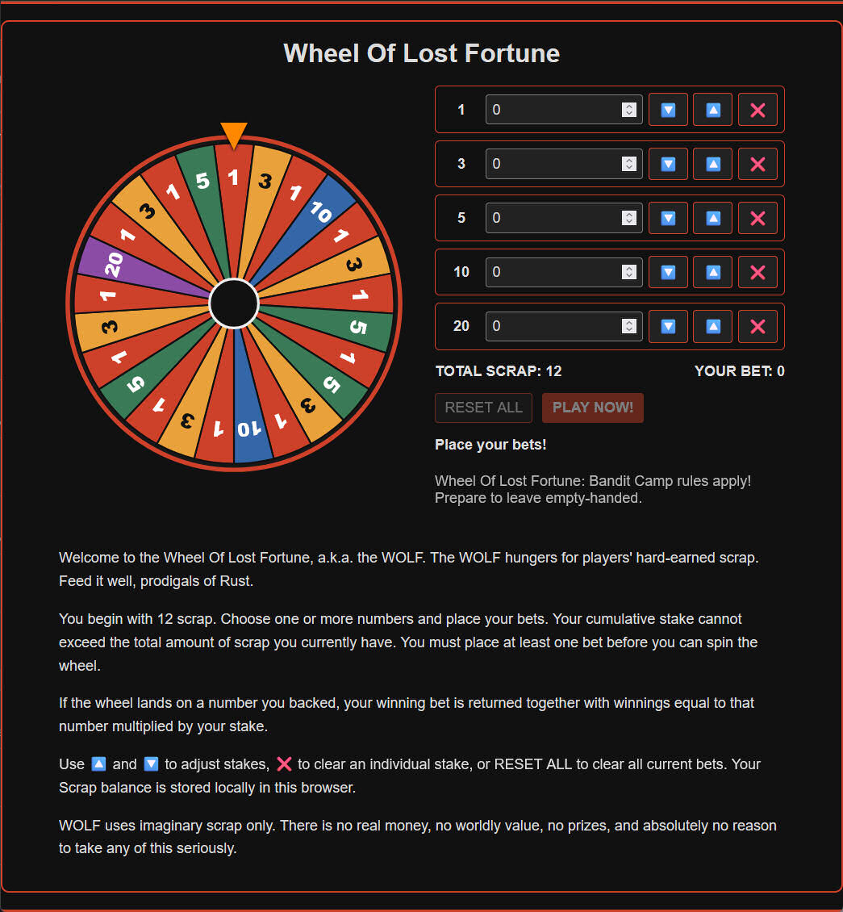

# Wheel Of Lost Fortune - a.k.a WOLF

Wheel Of Lost Fortune [WOLF] is a JavaScript browser game based on [Rust](https://rust.facepunch.com)'s Bandit Camp [Big Wheel](https://rust.facepunch.com/news/bandit-town-update#Casino) game.

WOLF is a conceptual Rust gambling game for fun and wasting free time. There's no actual currency involved and the <i>scrap</i> used as currency has no real world value. It's purely cosmetic for game purposes.

This software is for entertainment purposes only and is released under the [MIT License](LICENSE). The <i>scrap</i> is fictional in-game currency stored in the browser's `localStorage`.

### Play WOLF Live

Live WOLF v2.3.3 version: **[Play WOLF on Feroxi Forge website &#x2197;&#xFE0F; ](https://rust.penthux.net/index.php?p=wolf)**   
- *CTRL + Left-Click to open in a new browser tab.*

## Table of Contents

- [Running WOLF](#running-wolf)
- [WOLF Screenshot](#wolf-screenshot)
- [How to Play](#how-to-play)
  - [Placing Bets](#placing-bets)
  - [Wheel Sectors and Payouts](#wheel-sectors-and-payouts)
- [Scrap Balance and Storage](#scrap-balance-and-storage)
  - [Resetting Scrap](#resetting-scrap)
- [Project Files and Assets](#project-files-and-assets)
  - [Audio Assets](#audio-assets)
- [License](#license)
- [Copyright](#copyright)

## Running WOLF

WOLF is a browser-based game built with HTML, CSS and JavaScript.

1. Clone or download this repository.
2. Keep the directory structure and referenced assets intact.
3. Open [`index.html`](index.html) in your web browser.

No build step or package installation is required. JavaScript must be enabled in your browser.

To publish the game using GitHub Pages, see the [official GitHub Pages documentation](https://docs.github.com/en/pages/getting-started-with-github-pages/creating-a-github-pages-site).

## WOLF Screenshot



## How to Play

You begin with **12 Scrap**. Choose one or more numbers on the wheel and place your bets.

The wheel contains 25 sectors labelled 1, 3, 5, 10 and 20. Your total stake cannot exceed the amount of Scrap you currently own, and you must place at least one bet before spinning.

### Placing Bets

- Use the number fields to enter your stakes.
- Use 🔼 to increase a stake by one Scrap.
- Use 🔽 to decrease a stake by one Scrap.
- Use ❌ to clear an individual stake.
- Press **RESET ALL** to clear all current bets without changing your Scrap balance.
- Press **PLAY NOW!** to commit your total stake and spin the wheel.

Each spin takes approximately 10 seconds. Your bets are cleared when the spin finishes.

### Wheel Sectors and Payouts

| Number | Sectors | Chance | Winning payout |
| ---: | ---: | ---: | ---: |
| 1 | 12 of 25 | 48% | 2× stake |
| 3 | 6 of 25 | 24% | 4× stake |
| 5 | 4 of 25 | 16% | 6× stake |
| 10 | 2 of 25 | 8% | 11× stake |
| 20 | 1 of 25 | 4% | 21× stake |

A winning payout includes the return of your winning stake, plus winnings equal to the winning number multiplied by that stake.

For example, a 2-Scrap bet on 5 returns 12 Scrap if the wheel lands on 5: the original 2 Scrap plus 10 Scrap in winnings.

Your total stake is deducted before the spin. Stakes on losing numbers are lost, even if another number wins.

## Scrap Balance and Storage

Your Scrap balance is stored locally in your browser using `localStorage`.

The storage key is:

`feroxi_wolf_scrap`

The game initialises the balance at 12 Scrap when no valid saved balance exists. Your balance persists across page reloads and browser restarts within the same browser storage context.

Scrap is not held in a server-side account and is not shared between different browsers or devices. Reloading the page does not restore Scrap that you have lost.

### Resetting Scrap

If you run out of Scrap, you can manually restore your balance.

1. Open WOLF in your browser.
2. Open the browser's developer console.
3. Run the following JavaScript:

   ```javascript
   localStorage.setItem("feroxi_wolf_scrap", "12");
   location.reload();
   ```

**Note:** *12* is the amount of scrap to allocate. Increase/decrease this value accordingly.

Alternatively, remove the browser-stored value and let the game initialise it again:

```javascript
localStorage.removeItem("feroxi_wolf_scrap");
location.reload();
```

**Note:** The **RESET ALL** button only clears your current bets. It does not reset your Scrap balance.

Browser behaviour for `localStorage` when opening files directly using a `file://` URL can vary. Storage persistence depends on the browser and its storage context.

## Project Files and Assets

The game relies on its HTML, CSS, JavaScript and supporting assets being kept at their expected relative paths.

| File or directory | Description |
| --- | --- |
| [`index.html`](index.html) | HTML entry point for the game |
| [`css/feroxi.css`](css/feroxi.css) | Feroxi Forge stylesheet |
| [`js/feroxi_wolf.js`](js/feroxi_wolf.js) | Game logic, wheel animation, betting and Scrap storage |
| [`avhub/audio/`](avhub/audio/) | Sound effects used by the game |
| [`htm/font/`](htm/font/) | Font assets referenced by the stylesheet |
| [`img/`](img/) | Image assets referenced by GitHub README.md |
| [`LICENSE`](LICENSE) | Copyright notice &amp; MIT License terms |

### Audio Assets

The JavaScript references the following sound effects in `avhub/audio/`:

- `ratchet-clicking.mp3` — wheel ratchet sound.
- `wheel-spin-click-slow-down.mp3` — wheel slowdown sound.

Keep these files at their expected paths and retain their filenames so the game can load them correctly.

The same applies to the `feroxi_wolf.js` client-side game engine and `feroxi.css` stylesheet. If you move or rename any assets, update the corresponding reference in the code.

## License

WOLF is released under the [MIT License](LICENSE) and anyone is free to do with this software as they please. You are able to copy it, share it, distribute it, host it on your websites, or even make money from it. The only requirement is that you keep the "Copyright © 2026 Penthux.NET (rust.penthux.net)" notice and [MIT License](LICENSE) intact, whatever you choose to do with it.

```text
MIT License

Copyright © 2026 Penthux.NET (rust.penthux.net)

Permission is hereby granted, free of charge, to any person obtaining a copy
of this software and associated documentation files (the "Software"), to deal
in the Software without restriction, including without limitation the rights
to use, copy, modify, merge, publish, distribute, sublicense, and/or sell
copies of the Software, and to permit persons to whom the Software is
furnished to do so, subject to the following conditions:

The above copyright notice and this permission notice shall be included in all
copies or substantial portions of the Software.

THE SOFTWARE IS PROVIDED "AS IS", WITHOUT WARRANTY OF ANY KIND, EXPRESS OR
IMPLIED, INCLUDING BUT NOT LIMITED TO THE WARRANTIES OF MERCHANTABILITY,
FITNESS FOR A PARTICULAR PURPOSE AND NONINFRINGEMENT. IN NO EVENT SHALL THE
AUTHORS OR COPYRIGHT HOLDERS BE LIABLE FOR ANY CLAIM, DAMAGES OR OTHER
LIABILITY, WHETHER IN AN ACTION OF CONTRACT, TORT OR OTHERWISE, ARISING FROM,
OUT OF OR IN CONNECTION WITH THE SOFTWARE OR THE USE OR OTHER DEALINGS IN THE
SOFTWARE.
```

## Copyright

Copyright © 2026 Penthux.NET (rust.penthux.net)

\# F3F0    
\# 14N4<3:\*    
\#EOF<\*>

